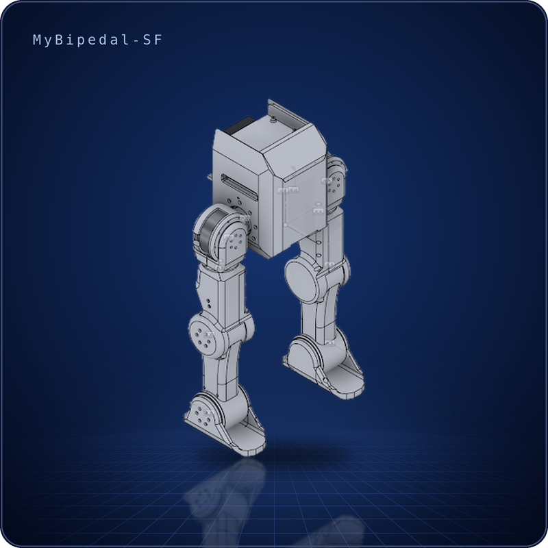
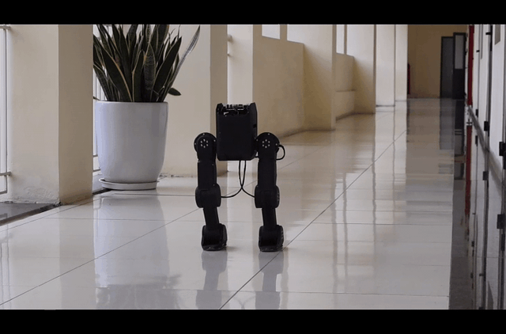
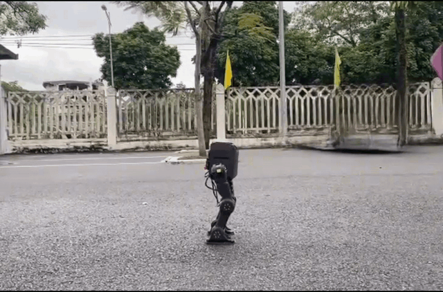
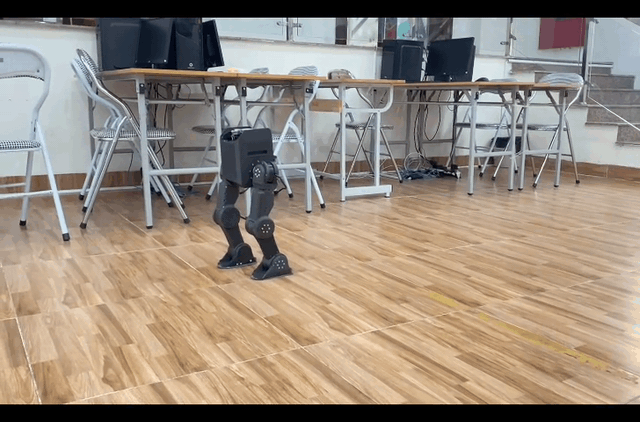
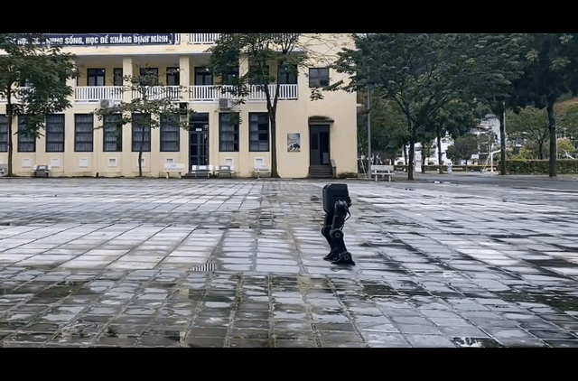
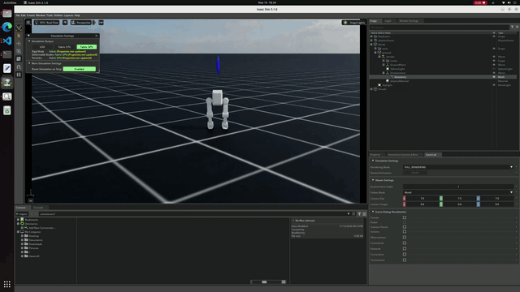
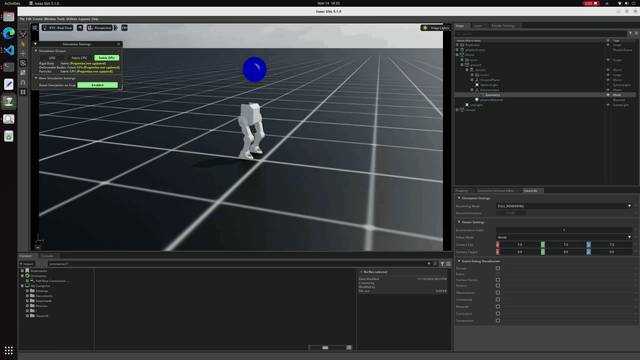
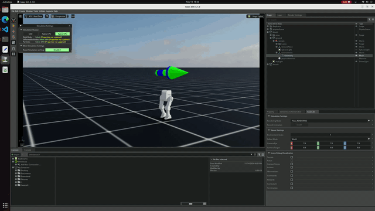
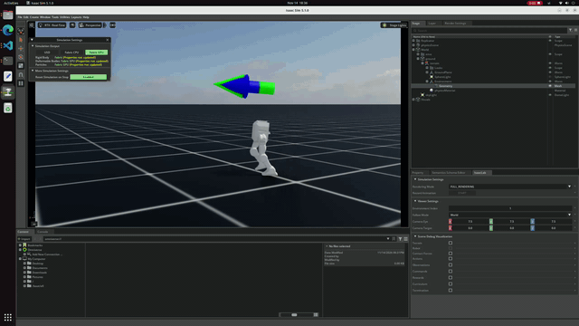

# mybipedal_rl_lab

> **Part of the MyBipedal open-source ecosystem.
Reinforcement learning training stack for the **MYBIPEDAL** bipedal
robot, built on top of
[Isaac Lab](https://isaac-sim.github.io/IsaacLab/) and using PPO to
train locomotion policies. This repository focuses on flat-terrain
training and supports the **SF** (sole-foot).

> **Scope:** flat-terrain, blind (no perception) velocity tracking.
> Trained policies are not included; you train them here and export
> TorchScript / ONNX for deployment.

## Highlights

- **Built-in velocity estimator.** An MLP encoder reads 10 steps of
  observation history and estimates base linear velocity, trained
  against the simulator's ground truth.
- **Deployment-ready export.** `play.py` writes TorchScript
  (`policy.pt`) and ONNX (`policy.onnx`, `encoder.onnx`) next to the
  checkpoint; the results in MuJoCo, Gazebo and on the real MYBIPEDAL are
  shown below.
Derived from LimX Dynamics' open-source `tron2_rl_lab` (Apache-2.0). All
MYBIPEDAL robot assets, configs and tasks have been removed

## Model lineup

| | Model | Description | DoF | Formats |
|:---:|---|---|:---:|---|
|  | **SF_MYBIPEDAL** | Biped with sole feet (ankle pitch). 10 position actions.<br>`Isaac-SF-MYBIPEDAL-Blind-Flat-v0` | 10 | USD · URDF · Xacro · MJCF |

## Results on the real robot and in simulation

**Real MYBIPEDAL** (SF reallife scene):

<p align="center">
  
  
  
  
</p>

**IsaacSim** (SF MYBIPEDAL):

<p align="center">
  
  
  
  
</p>

## Layout

```
exts/bipedal_locomotion/bipedal_locomotion/
├── assets/
│   ├── config/solefoot_mybipedal_cfg.py      # SF Mybipedal articulation / actuators
│   ├── config/wheelfoot_mybipedal_cfg.py     # WF Mybipedal articulation / actuators
│   └── usd/SF_MYBIPEDAL/                     # meshes, URDF, MuJoCo XML
├── tasks/locomotion/
│   ├── agents/mybipedal_rsl_rl_ppo_cfg.py    # PPO runner cfgs
│   ├── cfg/SF_MYBIPEDAL/, cfg/WF_MYBIPEDAL/    # base env cfgs (scene, obs, rewards, ...)
│   ├── robots/                             # env cfgs + gym registration
│   └── mdp/                                # rewards, observations, events, commands
└── utils/                                  # keyboard teleop, rsl_rl wrappers/export
rsl_rl/                                     # vendored RSL-RL fork
scripts/rsl_rl/                             # train.py, play.py, play_control.py
```

## Install

Requirements:

- **Isaac Sim 5.1** + **Isaac Lab 2.3.1**, obtained from NVIDIA (see
  [Scope](#scope))
- Python 3.10
- A CUDA-capable GPU (≥ 12 GB VRAM recommended for 4096-env training)

```bash
# 1. Clone the repository
git clone https://github.com/long-vuhoang/Mybipedal_rl_lab.git mybipedal_rl_lab
cd mybipedal_rl_lab
# 2. Inside your Isaac Lab python environment
pip install -e exts/bipedal_locomotion
pip install -e rsl_rl
```

## Tasks

| Task ID                          | Robot             |
|----------------------------------|-------------------|
| `SF-MYBIPEDAL-Blind-Flat-v0`       | Mybipedal sole-foot  |
| `SF-MYBIPEDAL-Blind-Flat-Play-v0`  | Mybipedal sole-foot (play) |
| `WF-MYBIPEDAL-Blind-Flat-v0`       | Mybipedal wheel-foot |
| `WF-MYBIPEDAL-Blind-Flat-Play-v0`  | Mybipedal wheel-foot (play) |

## Train

Replace `<TASK>` with a task ID from the [Model lineup](#model-lineup).
Task IDs are registered in
[exts/bipedal_locomotion/bipedal_locomotion/tasks/locomotion/robots/__init__.py](exts/bipedal_locomotion/bipedal_locomotion/tasks/locomotion/robots/__init__.py).

```bash
python scripts/rsl_rl/train.py --task SF-MYBIPEDAL-Blind-Flat-v0 --num_envs 4096 --headless
```

## Play

```bash
python scripts/rsl_rl/play.py --task SF-MYBIPEDAL-Blind-Flat-Play-v0 --num_envs 32
# with keyboard velocity teleop
python scripts/rsl_rl/play_control.py --task SF-MYBIPEDAL-Blind-Flat-Play-v0 --num_envs 1
```

Training outputs go to `logs/rsl_rl/` and are git-ignored, as are
`*.pt`, `*.onnx` and `*.jit` files.

## Scope

**Not included** — by design:

- **No trained policies** (`*.pt`, `*.pth`, `*.ckpt`, `*.onnx`,
  `*.jit`). Train them yourself.
- **No training logs, TensorBoard events, or Weights & Biases runs.**
  `logs/`, `wandb/`, `events.out.tfevents.*` are `.gitignore`'d and
  CI-blocked.
- **No Isaac Sim redistribution.** You must obtain NVIDIA Isaac Sim
  5.1 independently and accept the NVIDIA proprietary EULA before
  installing this stack. Nothing here grants an Isaac Sim license.
- **No GPU / driver bundling.** This repo does not ship drivers, CUDA,
  or PyTorch wheels.
- **No SDK binaries, firmware, calibration values, customer
  configuration, or vendor CAD.**

## Reference

- [Isaac Lab](https://github.com/isaac-sim/IsaacLab)
- [RSL-RL](https://github.com/leggedrobotics/rsl_rl) — upstream of
  the vendored fork under [`rsl_rl/`](rsl_rl).

## License & attribution

This project is distributed under the **Apache License, Version 2.0**
(January 2004). The full text is in [`LICENSE`](LICENSE) at the root
of the repository. SPDX identifier: `Apache-2.0`.

## Cite & support

If you use this training stack in academic or public work, please
cite the repository:

```
@misc{limx_tron2_rl_lab_2026,
  title  = {tron2_rl_lab: RL training stack for the LimX TRON2A bipedal robot},
  author = {LimX Dynamics},
  year   = {2026},
  howpublished = {\url{https://github.com/limxdynamics/tron2_rl_lab}}
}
```